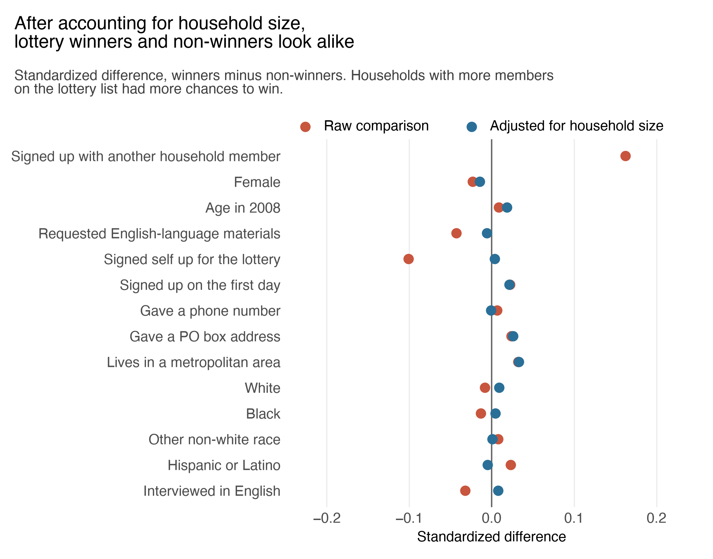
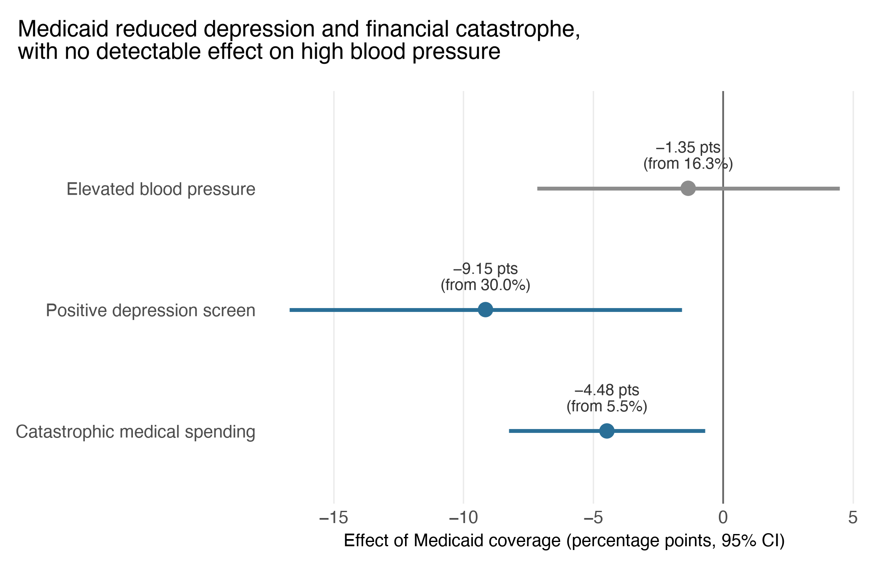
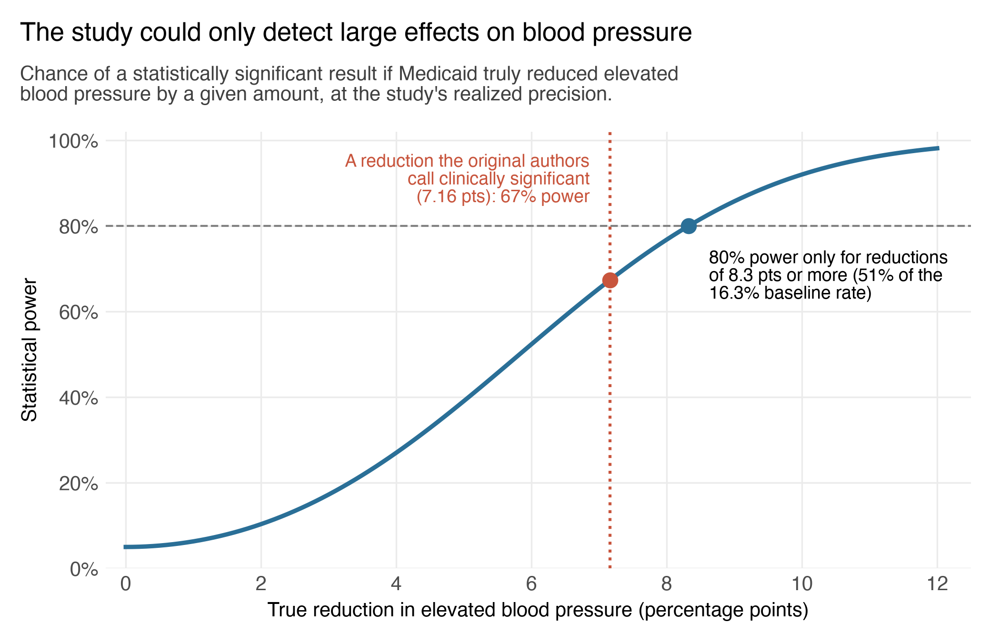

```{python}
import numpy as np
import pandas as pd
from IPython.display import Markdown

T = "output/tables/"
main = pd.read_csv(T + "main_effects.csv").set_index("outcome")
first = pd.read_csv(T + "first_stage.csv").iloc[0]
response = pd.read_csv(T + "response_rates.csv").iloc[0]
joint = pd.read_csv(T + "balance_joint_test.csv").iloc[0]
balance = pd.read_csv(T + "balance.csv")
power = pd.read_csv(T + "power_summary.csv").set_index("outcome")
needed = pd.read_csv(T + "sample_size_needed.csv").set_index("relative_reduction")
precision = pd.read_csv(T + "covariate_adjustment.csv").set_index("outcome")
bp_def = pd.read_csv(T + "check_bp_definition.csv")
relative = pd.read_csv(T + "check_relative_effects.csv").set_index("outcome")
clinical = pd.read_csv(T + "check_clinical_power.csv").iloc[0]

pts = lambda x, d=2: f"{x * 100:.{d}f}"          # proportion -> percentage points
pct = lambda x, d=0: f"{x * 100:.{d}f}%"         # proportion -> percent
neg = lambda s: s.replace("-", "−")              # typographic minus

def effect(outcome, d=2):
    r = main.loc[outcome]
    return neg(f"{pts(r.effect, d)} points (95% CI {pts(r.effect_low, d)} to {pts(r.effect_high, d)})")

def reduction(outcome, d=2):
    """A significant reduction, stated as a positive number of points."""
    r = main.loc[outcome]
    return f"{pts(-r.effect, d)} points (95% CI {pts(-r.effect_high, d)} to {pts(-r.effect_low, d)})"

bp, dep, cat = power.loc["hypertension"], relative.loc["depression"], relative.loc["catastrophic_spending"]
max_sd = np.ceil(balance["std_diff_adjusted"].abs().max() * 100) / 100
bp_main = main.loc["hypertension"]
```

## Summary

In 2008, Oregon could afford to expand Medicaid to only some of the low-income adults who wanted it, so it held a lottery. Because winners were chosen at random, the Oregon Health Insurance Experiment is one of the few randomized tests of what health insurance does. Its best-known clinical results, published by Baicker et al. in the *New England Journal of Medicine* in 2013, found that Medicaid reduced depression and financial hardship but produced "no significant improvements in measured physical health outcomes."

I rebuilt the analysis from the public-use data, reproducing every headline estimate in the paper, and then examined how well the evidence supports the way those results are described. **The estimates hold up; the summary language does not always.**

1. **The blood pressure "null" cannot distinguish no effect from a meaningful one.** The study had a `{python} pct(clinical.power)` chance of detecting a reduction the authors themselves call clinically significant, and 80% power only for reductions of at least `{python} pts(bp.mde, 1)` points, about half the baseline rate. Its 95% confidence interval runs from a `{python} pct(-bp_main.effect_low / bp_main.control_mean)` reduction to a `{python} pct(bp_main.effect_high / bp_main.control_mean)` increase.
2. **The positive findings are stated more precisely than the data allow.** "Nearly eliminated" catastrophic medical spending describes a point estimate whose 95% confidence interval is consistent with a reduction as small as `{python} pct(cat.relative_low)`. The "30% reduction" in depression has an interval running from `{python} pct(dep.relative_low)` to `{python} pct(dep.relative_high)`.
3. **The paper's definition of elevated blood pressure is misstated.** Table 2's footnote requires systolic pressure of at least 140 *and* diastolic of at least 90 mm Hg; the published results use *or*. Under the stated definition, `{python} pct(bp_def.control_rate[1], 1)` of the control group would have elevated blood pressure, not the reported 16.3%.

None of these overturns the paper's conclusions. Together they suggest the study is better read as **"Medicaid improved mental health and financial security, and the study was too small to say much about physical health"** than as evidence that Medicaid does not improve physical health.

## The experiment

Lottery winners won the chance to apply for Medicaid; many did not apply or did not qualify. Winning raised Medicaid enrollment from `{python} pct(first.enrolled_control)` to `{python} pct(first.enrolled_winners)`, an increase of `{python} pts(first.first_stage, 1)` percentage points. Comparing winners with non-winners therefore understates what coverage itself does.

To estimate the effect of *having* Medicaid, I use the lottery as an instrument for enrollment (two-stage least squares). Intuitively, since winning raised enrollment by about a quarter, the effect of coverage is roughly four times the effect of winning. The estimate applies to people who enrolled because they won, and it rests on two assumptions: winning affected health only through Medicaid, and nobody was made less likely to enroll by winning.

The analysis uses the 12,229 people who completed an in-person health exam from about two years after the lottery. Following the original study, all estimates use survey weights, cluster standard errors by household, and control for the number of household members on the lottery list.

## Was the lottery fair?

The lottery drew households, not people, so people who signed up with a household member had more chances to win. After accounting for that, winners and non-winners are nearly identical on every characteristic recorded before the drawing and at the exam (all standardized differences below `{python} f"{max_sd:.2f}"` standard deviations). Together the characteristics cannot predict who won (joint test p = `{python} f"{joint.p_value:.2f}"`), and winners and non-winners completed the exam at the same rate (`{python} pct(response.rate_winners, 1)` vs. `{python} pct(response.rate_control, 1)`, p = `{python} f"{response.p_value:.2f}"`).

{width=85%}

## What Medicaid did

```{python}
rows = []
for outcome, r in main.iterrows():
    rows.append({
        "Outcome": r.label,
        "Rate among non-winners": pct(r.control_mean, 1),
        "Effect of Medicaid, points (95% CI)":
            neg(f"{pts(r.effect)} ({pts(r.effect_low)} to {pts(r.effect_high)})"),
    })
Markdown(pd.DataFrame(rows).to_markdown(index=False))
```

Having Medicaid reduced positive depression screens by `{python} reduction("depression")` and catastrophic medical spending (out-of-pocket costs above 30% of income) by `{python} reduction("catastrophic_spending")`. The estimated effect on elevated blood pressure was small and not statistically significant: `{python} effect("hypertension")`. These reproduce the published estimates (see [Reproducibility](#reproducibility)).

{width=85%}

## Re-examining the evidence

### A null result from a study too small to detect it

The original authors acknowledge that their power to detect changes in physical health was limited, and note that their confidence interval includes a clinically significant 7.16-point reduction in hypertension. The power curve below makes that caveat concrete.

{width=85%}

Because only a quarter of winners gained coverage, the study's precision for the effect of Medicaid is far lower than its 12,000-person sample suggests. Detecting a 20% reduction in elevated blood pressure (`{python} pts(needed.loc[0.2, "effect_pts"], 1)` points) with 80% power would have required about `{python} f"{needed.loc[0.2, 'n_needed'] / 1000:.0f}"`,000 people, `{python} f"{needed.loc[0.2, 'times_actual']:.1f}"` times the actual sample. The study can rule out very large effects; it cannot rule out moderate ones.

### Headline magnitudes versus their uncertainty

The paper's abstract describes catastrophic expenditures as "nearly eliminated," and the results section reports a relative reduction of "more than 80%." That is the point estimate. Expressed relative to the `{python} pct(cat.control_rate, 1)` rate among non-winners, the 95% confidence interval runs from a `{python} pct(cat.relative_low)` reduction to complete elimination. The depression estimate, reported as a 30% reduction, has an interval from `{python} pct(dep.relative_low)` to `{python} pct(dep.relative_high)`.[^relative]

[^relative]: Relative intervals divide the confidence limits for the effect by the control-group rate, treating that rate as fixed. They are approximate but adequate for comparing with the paper's own relative statements.

These are real effects: both intervals exclude zero. But the summary language describes the most likely value, while the null findings for physical health are, appropriately, discussed in terms of their uncertainty. Applying the same standard to both gives a more cautious picture of the financial and mental-health benefits.

### A misstated definition

```{python}
Markdown(pd.DataFrame({
    "Definition": bp_def.definition.str.replace(">=", "at least"),
    "Control-group rate": [pct(x, 1) for x in bp_def.control_rate],
    "Effect of Medicaid (points)": [neg(pts(x)) for x in bp_def.effect],
}).to_markdown(index=False))
```

Table 2 of the paper defines elevated blood pressure as systolic pressure of at least 140 *and* diastolic pressure of at least 90 mm Hg. The reported control-group rate of 16.3% is reproduced only with *or*, which is the standard clinical threshold and the definition in the authors' replication code. This is a documentation error rather than an analytical one, but a reader applying the stated definition would get different results.

## Could better analysis recover the lost precision?

In A/B testing, adjusting for characteristics measured before treatment is a standard way to tighten estimates (e.g., CUPED). I re-estimated each effect adding sex, age, race, ethnicity, language, and lottery sign-up characteristics as controls.

```{python}
Markdown(pd.DataFrame({
    "Outcome": precision.label,
    "Variance explained by covariates": [pct(x) for x in precision.covariate_r2],
    "Reduction in standard error": [neg(pct(x, 1)) for x in precision.se_reduction],
}).to_markdown(index=False))
```

It barely helps. Standard errors shrink by at most about 1%, because the available covariates explain only `{python} pct(precision.covariate_r2.min())`–`{python} pct(precision.covariate_r2.max())` of the variation in outcomes. Adjustment pays off when a covariate strongly predicts the outcome, typically a measurement of the outcome itself before treatment. The study never measured participants' blood pressure before the lottery, and no demographic substitute can make up for it.

## Limitations

- **Who the estimates describe.** The effects apply to low-income Portland-area adults who signed up for the lottery and enrolled because they won, and to roughly 17 months of coverage on average.
- **Scope.** I examine three of the paper's outcomes. The original study reports many more, including diabetes diagnosis and medication, where it did find effects.
- **Power calculations.** These use the study's realized standard errors, so they describe the design as executed rather than as planned.

## Reproducibility {#reproducibility}

The data are the Oregon Health Insurance Experiment public-use files, available from NBER under a data-use agreement. The full analysis is implemented in both R and Python, and the two agree on every estimate to at least four decimal places. Both also reproduce the published results:

| Estimate | This analysis | Baicker et al. (2013) |
|---|---|---|
| Lottery's effect on Medicaid enrollment | `{python} pts(first.first_stage, 1)` | 24.1 |
| Lottery's effect on exam response | `{python} pts(response.diff_adjusted)` (p = `{python} f"{response.p_value:.2f}"`) | 0.28 (p = 0.86) |
| Elevated blood pressure | `{python} neg(pts(main.loc["hypertension", "effect"]))` | −1.33 |
| Positive depression screen | `{python} neg(pts(main.loc["depression", "effect"]))` | −9.15 |
| Catastrophic medical spending | `{python} neg(pts(main.loc["catastrophic_spending", "effect"]))` | −4.48 |

The blood pressure estimate differs from the published value by 0.02 points; the source of the gap is unidentified.

**Reference.** Baicker, K., Taubman, S. L., Allen, H. L., et al. (2013). The Oregon Experiment — Effects of Medicaid on Clinical Outcomes. *New England Journal of Medicine*, 368(18), 1713–1722.

**Data.** Oregon Health Insurance Experiment, public-use data. National Bureau of Economic Research. <https://www.nber.org/research/data/oregon-health-insurance-experiment-data>
